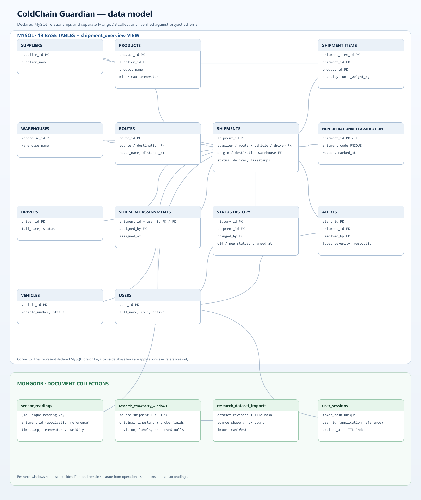
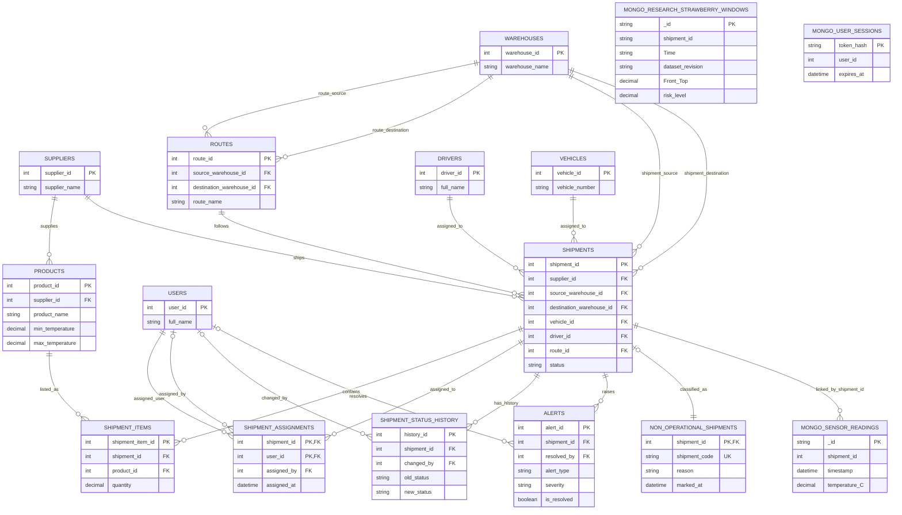

# ColdChain Guardian ER diagram

The generated PNG and SVG are kept beside this editable Mermaid source.

This diagram reflects the connected local MySQL schema inspected on 26 October 2026. It shows declared foreign keys from `information_schema`; the lines do not infer any undocumented relationship. `shipment_overview` is a view, not a base table. MongoDB readings are shown separately because MySQL cannot declare a foreign key into MongoDB.

## Reading the diagram

- A shipment references its supplier, origin and destination warehouses, vehicle, driver, and route through the foreign keys declared on `shipments`.
- A shipment can contain multiple products through `shipment_items`; each item stores quantity and unit weight. Product temperature limits are stored on `products`.
- `shipment_status_history` and `alerts` belong to a shipment. Optional `changed_by` and `resolved_by` references point to `users`.
- `shipment_assignments` maps operations staff users to shipments. It also records the manager/admin account that made the assignment; the composite primary key prevents duplicate assignment rows.
- `routes` references warehouses twice, once as source and once as destination. The labels distinguish the two real foreign keys.
- The MongoDB document contains a `shipment_id` value, which the application uses to join the readings to the MySQL shipment. MongoDB does not enforce that cross-database relationship.
- `non_operational_shipments` classifies excluded demo rows without deleting shipments or their linked records. Its shipment ID and code are protected by a foreign key and unique key.
- `research_strawberry_windows` is a separate MongoDB collection. Its `S1`–`S6` IDs are source identifiers, not references to operational MySQL shipments.
- `user_sessions` is a separate MongoDB collection. Its `user_id` refers to MySQL users at the application layer and is not a cross-database foreign key.
- The schema source contains the original 11 relational tables plus `non_operational_shipments` and `shipment_assignments` (13 base tables), and the `shipment_overview` view.

## Database fit

MySQL is appropriate for entities that need explicit keys, constraints, and multi-table joins: shipments, products, suppliers, inventory items, and alert ownership. MongoDB holds operational timestamped observations in `sensor_readings` and published research windows in `research_strawberry_windows`. The application keeps the datasets separate; only operational readings are associated with operational MySQL shipment IDs.
