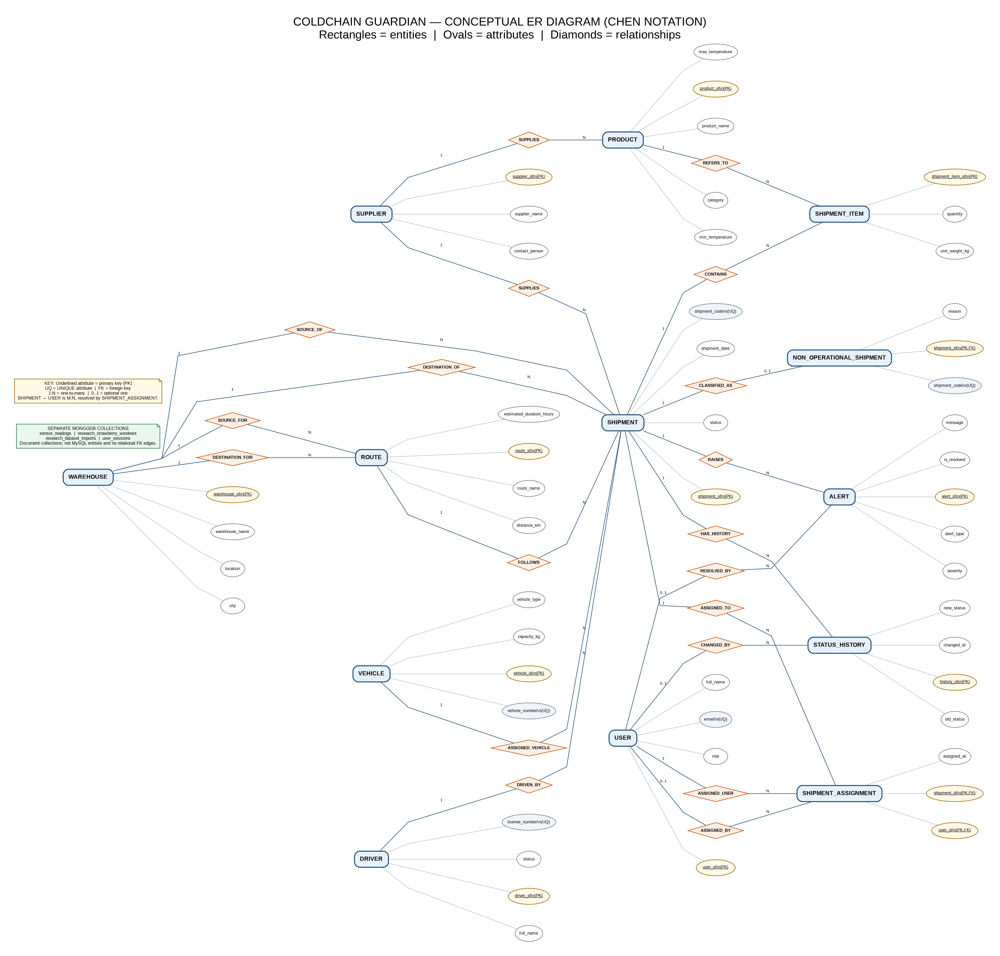
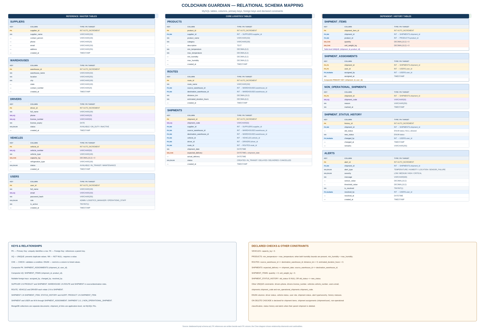

# ColdChain Guardian data model

## Conceptual ER diagram

This Chen diagram presents the project entities, their relationships, and selected identifying or domain attributes. Its MySQL relationships correspond to the foreign keys declared in [`database/mysql-schema.sql`](../database/mysql-schema.sql): suppliers and products; shipment suppliers, origin and destination warehouses, routes, vehicles and drivers; shipment items, alerts, status history and assignments; and the optional non-operational classification. `shipment_assignments` resolves the many-to-many relationship between shipments and users, while also recording the assigning user.

The project has 13 MySQL base tables and the `shipment_overview` view. The diagram notes the separate MongoDB collections (`sensor_readings`, `research_strawberry_windows`, and `user_sessions`); these are documents, not MySQL entities, and their application-level IDs do not create cross-database foreign keys.

## Relational schema mapping

This mapping shows the columns, data types, primary and foreign keys, nullability, unique keys, enums, and declared checks for the MySQL tables. The authoritative definitions are in [`database/mysql-schema.sql`](../database/mysql-schema.sql); update that file and the diagram together if the schema changes.
